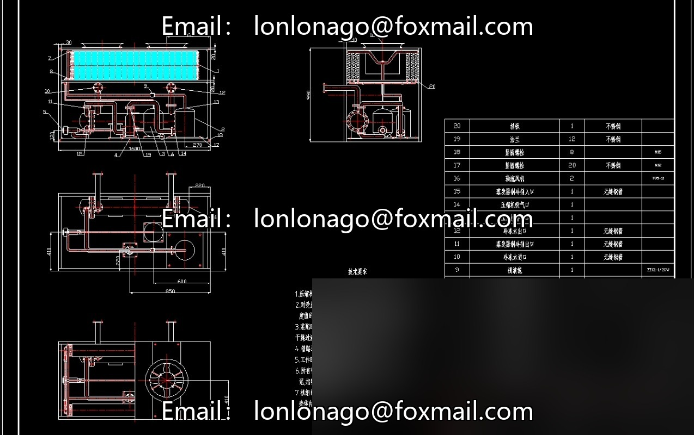
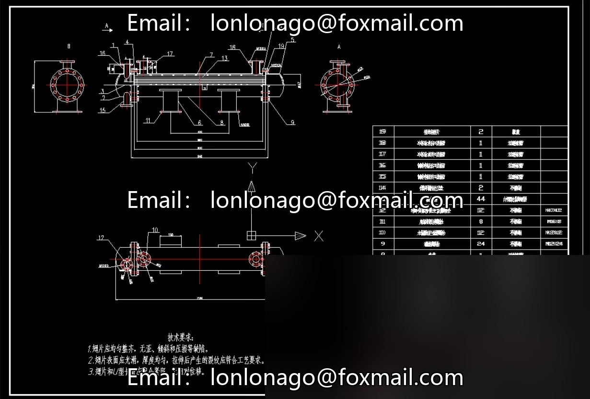
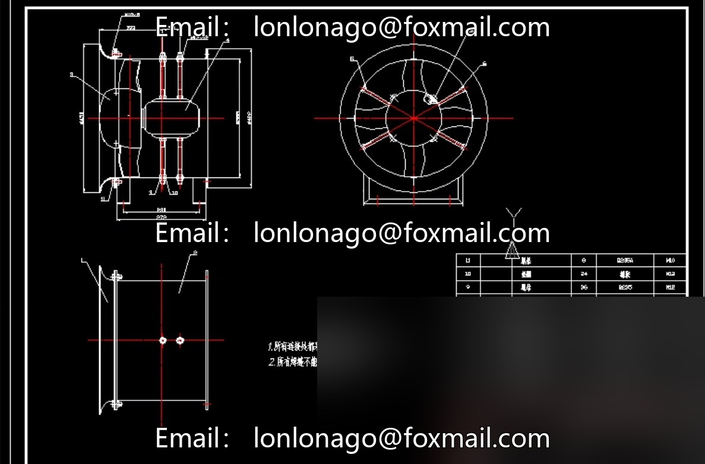

# Cold water heat pump design; Cold water heat pump diagram; Cold water heat pump design diagram

## Body

Reliant Compressor Design; Relicant Compressor Figure; Relicant Compressor Design Figure; Relicant Compressor CAD Figure; Relicant Compressor Design CAD Figure

Design drawings are provided for a wind-cooled chill circuit unit, including the overall assembly drawing, condenser and evaporator assembly drawings, main component drawings, and the design manual in CAD format.

<!-- AI_ENRICHED -->

## Images

## Payment

Here is a pay link on Stripe ( https://buy.stripe.com/3cs8yP7sY87d0vu9AB ). Please contact me lonlonago@foxmail.com after funding $89, and I will send you a complete data files , thank you!

